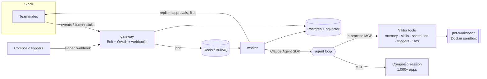

# Viktor

**An open-source AI employee that lives in Slack.** Mention it in a channel or DM it real work — "pull last month's Stripe revenue and send me a PDF with charts", "every Monday post the PRs waiting on review", "when a new lead lands in HubSpot, research the company" — and it does the work end to end using your team's apps and its own computer.

Built on the [Claude Agent SDK](https://code.claude.com/docs/en/agent-sdk), with every third-party integration (Gmail, Google Sheets & Docs, Outlook, Excel, Word, GitHub, Linear, Notion, HubSpot, Salesforce, Stripe and 1,000+ more) powered by [Composio](https://composio.dev).

Inspired by [viktor.com](https://viktor.com).

---

## What it can do

| | |
|---|---|
| **Works like a teammate in Slack** | @mention it anywhere or DM it. Follow-ups in the same thread just work. Live progress shows what it's doing. |
| **Uses your apps** | One Composio session per workspace gives it every app you connect. Missing an app? It posts a one-click **Connect** button. Connections are shared with the whole team. |
| **Has its own computer** | A hardened, per-workspace Docker sandbox with Python, Node, LibreOffice and pandoc. It analyses data and produces real files (PDF, XLSX, DOCX, PPTX, charts) and uploads them to the thread. Files you attach in Slack land in its inbox. |
| **Asks before risky actions** | Anything that sends, creates, updates or deletes in another system pauses for an **Approve / Deny / Always allow** card. Reads and drafts run freely. |
| **Remembers** | Long-term memory with hybrid search (Postgres full-text + pgvector). It saves durable facts on its own and recalls what's relevant every turn. |
| **Learns skills** | After a multi-step task it will likely be asked again, it writes itself a playbook and follows it next time. |
| **Recurring work** | "Every weekday at 9…" becomes a real cron schedule, run in the workspace's timezone in a fresh thread. |
| **Reacts to events** | Subscribes to Composio triggers (new email, new issue, new deal…) and handles each event with the instruction you gave it. |
| **Proactive** | Watches channels you opt in, quietly remembers decisions and jumps in only when it can clearly help (cheap Haiku triage first). Optional weekday-morning check-in with automation offers. |
| **Admin controls** | Slack **App Home**: usage vs. monthly budget, connected apps, watched channels, schedules, triggers, memories, skills, always-allowed actions, settings and a one-click **wipe**. |

## Architecture



- **gateway** acknowledges Slack within 3 seconds and never runs the agent. It handles the OAuth install, App Home, approval clicks and Composio webhooks, and turns everything into queued jobs.
- **worker** runs the agent with the Claude Agent SDK. Built-in shell and file tools are disabled; code only ever runs inside the sandbox, which holds no secrets. Agent transcripts are mirrored to Postgres through the SDK's `SessionStore`, so any worker can resume any Slack thread.
- **Approvals** are enforced in the SDK's `canUseTool` hook, not by asking the model nicely. Decisions travel from the button click to the waiting run over Redis pub/sub.

A deeper walkthrough lives in [docs/architecture.md](docs/architecture.md).

## Quickstart

**You need:** Node 22.18+, pnpm 10, Docker, an [Anthropic API key](https://console.anthropic.com), a [Composio API key](https://platform.composio.dev), and a public HTTPS URL for local development (e.g. `cloudflared tunnel --url http://localhost:3000`).

```sh
git clone <this repo> viktor && cd viktor
pnpm install
cp .env.example .env               # fill in keys; generate ENCRYPTION_KEY with: openssl rand -hex 32
docker compose up -d               # postgres (pgvector) + redis
docker build -t viktor-sandbox:latest sandbox-image
```

**Try it in your terminal first** (no Slack app required):

```sh
pnpm chat
```

**Then connect Slack:**

1. Create an app at [api.slack.com/apps](https://api.slack.com/apps) → *From a manifest* → paste [`slack-manifest.yaml`](slack-manifest.yaml) after replacing `https://viktor.example.com` with your `PUBLIC_URL`.
2. Copy the client ID, client secret and signing secret into `.env`.
3. Start everything: `pnpm dev` (gateway on `PORT`, worker alongside).
4. Visit `PUBLIC_URL/slack/install` to install it into your workspace. Viktor will DM you.
5. Optional, for event triggers: `pnpm --filter @viktor/gateway register-webhook` and put the printed secret in `COMPOSIO_WEBHOOK_SECRET`.

**Run it as containers:**

```sh
docker compose --profile app up -d --build
```

The worker mounts the Docker socket to manage sandbox containers. On a shared host, run the worker on a dedicated machine or point it at a remote Docker daemon.

## Configuration

Every option is documented in [`.env.example`](.env.example). The ones you'll most likely touch:

| Variable | Default | |
|---|---|---|
| `AGENT_MODEL` | `claude-opus-5-5` | Model for agent runs |
| `FAST_MODEL` | `claude-haiku-5-5` | Model for channel triage |
| `AGENT_EFFORT` | `high` | Reasoning effort for agent runs |
| `AGENT_MAX_RUN_USD` | `5` | Hard spend cap per task |
| `DEFAULT_MONTHLY_BUDGET_USD` | `100` | Per-workspace monthly cap (editable in App Home; `0` = unlimited) |
| `APPROVAL_TIMEOUT_MS` | 15 min | How long a gated action waits for a human |
| `SANDBOX_MEMORY_MB` / `SANDBOX_CPUS` | 2048 / 1 | Sandbox resource limits |
| `VOYAGE_API_KEY` | – | Enables semantic memory search |

## Security model

- **Least privilege for the agent.** No host shell or filesystem tools. The sandbox runs as uid 1000 with a read-only root filesystem, all capabilities dropped, `no-new-privileges`, and CPU / memory / PID limits. It never receives API keys; the agent subprocess gets only the variables it needs.
- **Humans approve side effects.** Tool calls are classified by verb (`SEND`, `CREATE`, `UPDATE`, `DELETE`, `MERGE`…). Writes wait for the requester or a workspace admin; only admins can "always allow". Drafts and reads go through.
- **Untrusted content stays data.** Tool results, emails, web pages, channel messages and trigger payloads are labelled as untrusted in the prompt, and the approval gate backs that up when the model gets it wrong. The eval suite includes a prompt-injection scenario.
- **Secrets at rest.** Slack installations are encrypted with AES-256-GCM. Composio holds third-party OAuth tokens; Viktor never sees them.
- **Tenant isolation.** Every workspace has its own Composio user, sandbox container and volume, and its own rows in every table.
- **Right to forget.** *Wipe* in App Home deletes memories, skills, schedules, triggers, transcripts and sandbox files, keeping only cost totals.
- **Budgets.** Per-task and per-workspace monthly spend caps; schedules can't run more often than every 15 minutes; triggers and proactive replies are rate limited.

## Project layout

```
apps/gateway      Slack Bolt app: OAuth install, events, App Home, approvals, Composio webhooks
apps/worker       BullMQ consumers: agent runs, schedules, triggers, triage, check-ins, wipes; `pnpm chat`
packages/agent    Agent SDK wrapper, prompts, approval policy, Postgres session store, Haiku triage
packages/tools    In-process MCP tools: sandbox, files, memory, skills, schedules, triggers
packages/composio Per-workspace Composio sessions, connections, triggers
packages/sandbox  Hardened Docker sandboxes (dockerode)
packages/slack    Block Kit builders, progress message, markdown chunking
packages/db       Drizzle schema, migrations, repositories, encryption
packages/queue    Typed queues, job schedulers, approval pub/sub
packages/config   Validated env and logger
sandbox-image     The sandbox's Dockerfile
evals             Behaviour scenarios run against the real agent
```

## Development

```sh
pnpm lint && pnpm typecheck && pnpm test     # what CI runs
SANDBOX_IT=1 pnpm --filter @viktor/sandbox test   # sandbox isolation tests (needs Docker + the image)
pnpm eval                                    # behaviour evals; uses real API calls and costs money
```

TypeScript runs natively on Node (type stripping), so there's no build step.

## Roadmap

- Microsoft Teams
- Per-user private mode and per-user app connections
- Building and hosting small internal web apps from the sandbox
- Web dashboard and SSO
- Streaming answers with Slack's native streaming API

## License

[MIT](LICENSE)
