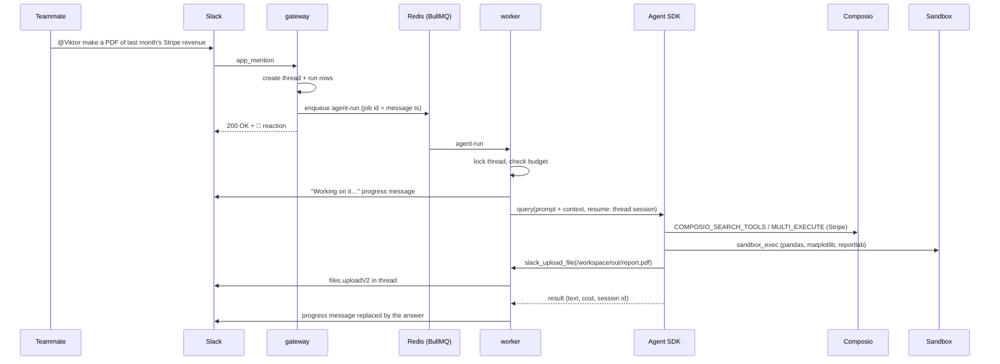
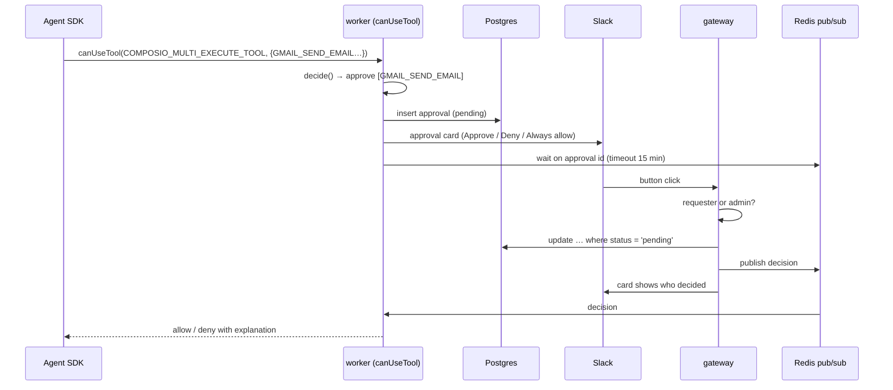

# Architecture

This document walks through how a Slack message becomes finished work, and the design decisions behind each piece.

## Life of a request

1. **Intake (gateway).** Bolt verifies the Slack signature and the gateway does the minimum: it records the thread and a `queued` run, enqueues a job keyed by the message timestamp (Slack retries become no-ops), and reacts with 👀. Follow-up messages in a thread Viktor already joined are picked up without another mention.
2. **One run per thread.** The worker takes a Redis lock per Slack thread. A second message in the same thread waits instead of racing the first.
3. **Context assembly.** Each turn's prompt starts with a `<context>` block: current time in the workspace's timezone, who asked, the relevant memories, the skill index, which apps are connected, imported attachments, and for a thread Viktor is joining late, the conversation so far. The system prompt holds only stable instructions, so it can be snapshotted per session and cached across workspaces (`SYSTEM_PROMPT_DYNAMIC_BOUNDARY` separates the global part from the workspace part).
4. **The agent loop.** `runAgent` calls the Claude Agent SDK's `query()` with:
   - `tools: ["WebSearch", "WebFetch", "TodoWrite"]`. The built-in Bash, Read, Write and Edit tools are not exposed at all.
   - Two MCP servers: the workspace's **Composio** session over HTTP, and Viktor's own **in-process** server (`createSdkMcpServer`) with sandbox, file, memory, skill, schedule and trigger tools bound to this conversation.
   - `canUseTool` set to the approval gate, and a `PostToolUse` hook that turns Composio connection links into Slack buttons.
   - `sessionStore` set to Postgres, `maxTurns`, `maxBudgetUsd`, and a wall-clock timeout.
   - A minimal subprocess environment. The agent process never sees the database URL, Slack tokens or the encryption key.
5. **Delivery.** Tool calls stream into the progress message as human-readable steps. The final answer replaces it in place, split into Markdown blocks when it's long.
6. **Accounting.** Cost and tokens are written to the run. Resumed SDK sessions report cumulative cost, so each thread stores its running total and the run records the difference.

## Composio: one identity per workspace

Viktor is a shared teammate, so integrations belong to the workspace rather than the individual: the Composio user id is `slack_<team id>`. One Tool Router session per workspace is created on demand, persisted, and reused. The agent talks to it over MCP and gets Composio's meta tools:

- `COMPOSIO_SEARCH_TOOLS` to find the right tool among 1,000+ apps,
- `COMPOSIO_MULTI_EXECUTE_TOOL` to run one or more of them,
- `COMPOSIO_MANAGE_CONNECTIONS` to produce an OAuth link when an app isn't connected yet.

Composio's own remote sandbox is disabled for these sessions, so code runs in exactly one place: Viktor's container.

The App Home's *Connect an app* button and the `PostToolUse` hook both end in a Composio-hosted OAuth page. The callback lands on a small page in the gateway.

**Triggers** use the same identity. `trigger_subscribe` creates a Composio trigger instance and stores the instruction and target channel. Composio delivers events to `/webhooks/composio`, where the gateway verifies the signature, looks up the subscription and enqueues a job keyed by the event id. The worker opens a new thread in the channel and runs the instruction with the event payload, which is clearly marked as untrusted data.

## The approval gate

`decide()` is a small pure function, covered by unit tests:

- Viktor's own tools and the safe built-ins are always allowed. The sandbox is isolated and uploads only go to the requesting thread.
- Composio discovery and connection meta tools are allowed.
- For `COMPOSIO_MULTI_EXECUTE_TOOL`, every nested tool slug is classified. Slugs containing a write verb (`SEND`, `CREATE`, `UPDATE`, `DELETE`, `MERGE`, `POST`, …) need approval. Read-only verbs pass, and so do drafts that aren't also sends.
- Proxy calls are allowed for `GET` only.
- Anything unknown needs approval.
- Slugs an admin marked *Always allow* skip the gate.

The decision is applied atomically (`update … where status = 'pending'`), so double clicks and two approvers at once can't both win. The waiter also re-reads the row after subscribing, so a click that lands before the subscription isn't lost.

## Memory and skills

Memories are short, self-contained facts with an optional embedding. Search is hybrid: Postgres full-text (`websearch_to_tsquery` over a generated `tsvector`) and, when `VOYAGE_API_KEY` is set, pgvector cosine similarity (HNSW index). The two rankings are merged with reciprocal rank fusion, so neither score needs calibrating against the other.

Memories reach the model three ways:
- the top matches for the incoming message are injected into every turn,
- the `recall` tool for deliberate lookups,
- watched channels, where the triage step can save facts it overhears (marked with a 🧠 reaction).

Skills are Markdown playbooks the agent writes for itself with `skill_save`, for example how this team likes its weekly KPI report built, which tool slugs to use, and where the script lives in `/workspace`. The index of skill names and descriptions is in every turn's context; the agent reads the full skill when a task matches.

## The sandbox

Each workspace gets one long-lived container (`viktor-sbx-<team>`) built from `sandbox-image/`:

| Control | Setting |
|---|---|
| User | uid 1000, never root |
| Root filesystem | read-only; `/tmp` is a 512 MB tmpfs |
| Persistent storage | named volume at `/workspace` (pip and npm installs go there too) |
| Capabilities | all dropped, `no-new-privileges` |
| Limits | memory (no swap), CPUs, 512 PIDs, per-command timeout |
| Secrets | none; only `VIKTOR_WORKSPACE` is set |

Files move in and out with Docker's archive API (tar streams) rather than bind mounts, and every path is resolved and checked to stay under `/workspace`. Idle containers are stopped after `SANDBOX_IDLE_MINUTES`; the volume persists. The isolation properties are covered by integration tests that run in CI.

## Schedules, triggers and proactivity

- **Schedules** are rows in Postgres mirrored into BullMQ job schedulers (`upsertJobScheduler` with the cron pattern and IANA timezone). On boot the worker re-registers every enabled schedule, so losing Redis never silently drops one. Crons that fire more often than every 15 minutes are rejected.
- **Watched channels** send each new message (outside threads Viktor is already part of) to a triage step on Claude Haiku with structured output: `ignore`, `remember` (with the fact), or `respond`. Only `respond` starts a full agent run, capped per channel per hour, and the agent is told that nobody asked it directly.
- **The daily check-in** is a weekday 9:00 job scheduler per workspace. It gives the agent a summary of the last 24 hours (failures, pending approvals, active schedules) and asks for a short briefing plus up to three automation offers.

## Data model

| Table | Purpose |
|---|---|
| `workspaces` | Slack installation (encrypted), timezone, budget, settings, Composio session id |
| `threads` | Slack thread → Agent SDK session id and running cost |
| `runs` | Every agent run: trigger, status, result, tokens, cost |
| `agent_session_entries` | Agent SDK transcripts (via `SessionStore`) |
| `approvals` | Gated tool calls and who decided |
| `memories` | Facts, `tsvector`, optional `vector(1024)` |
| `skills` | Agent-written playbooks |
| `schedules` | Recurring prompts |
| `trigger_subscriptions` | Composio trigger instances and their instructions |
